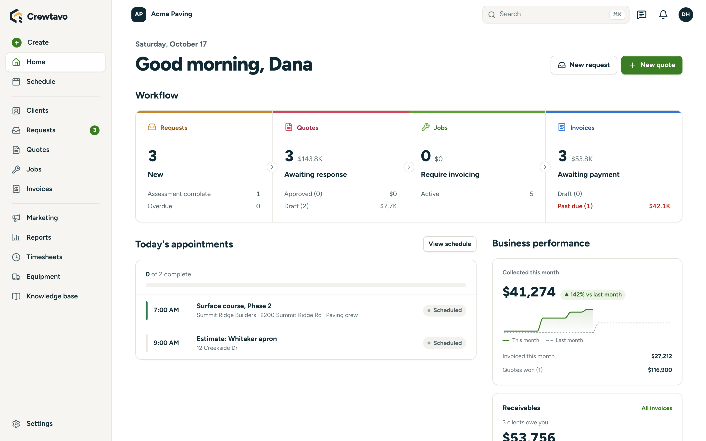
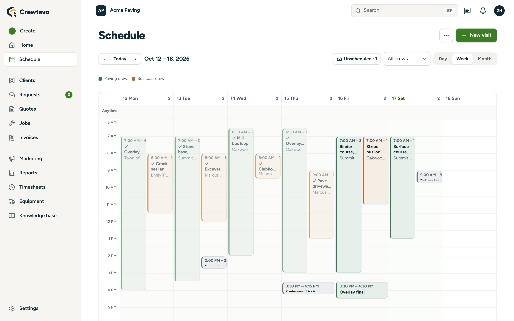
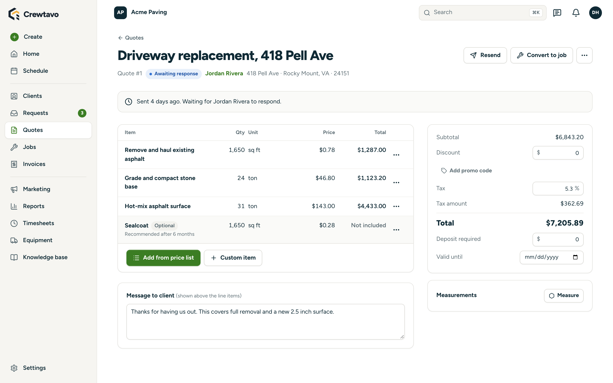
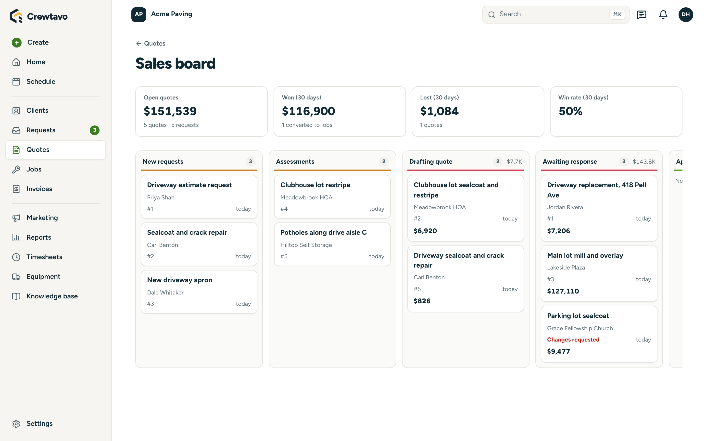
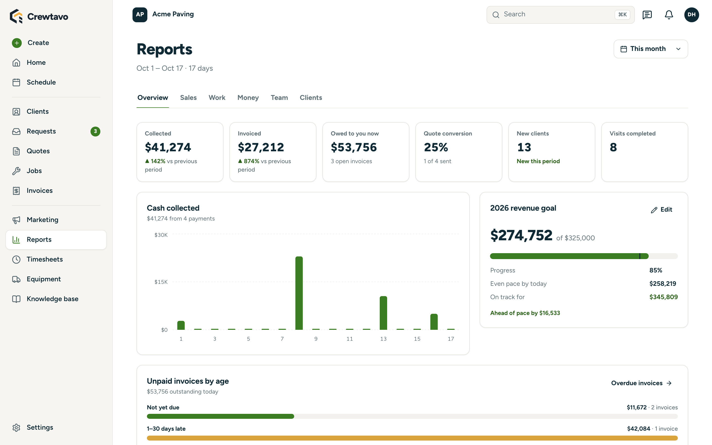
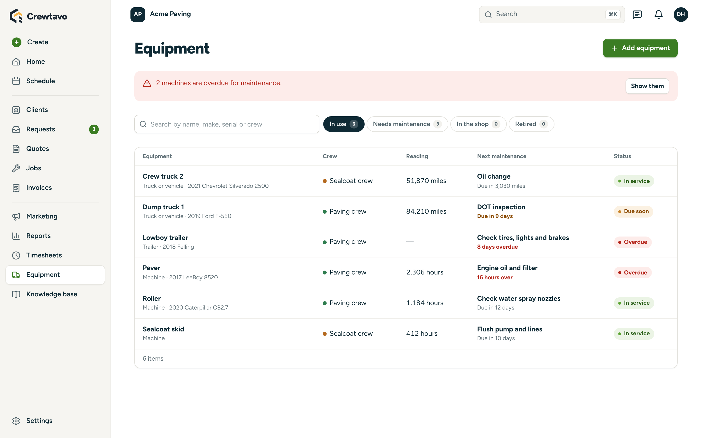
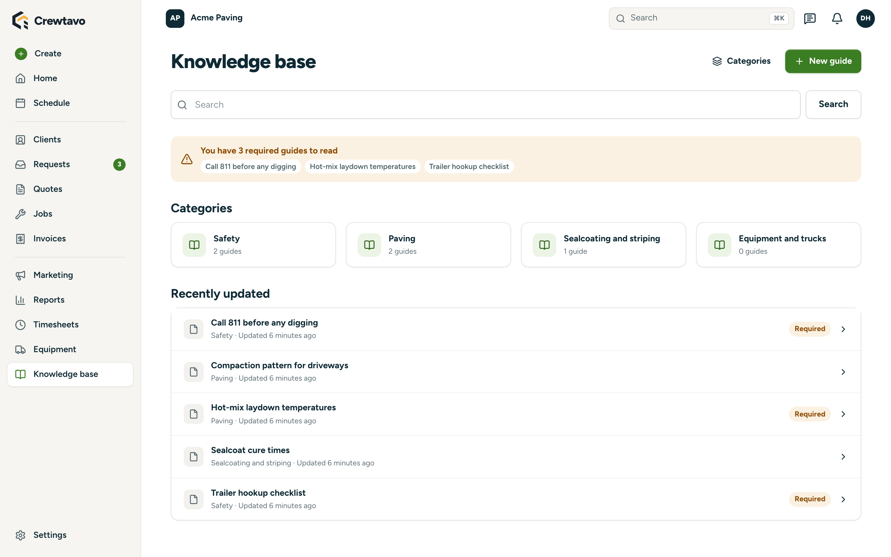
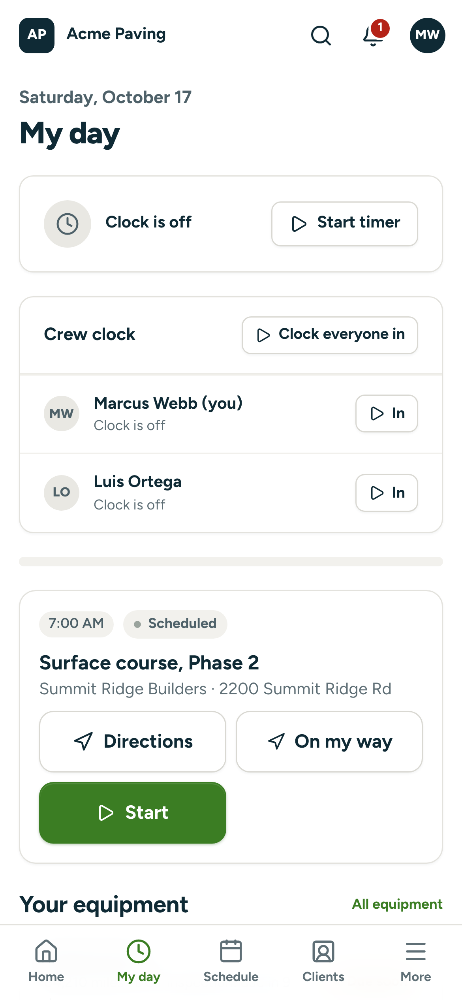
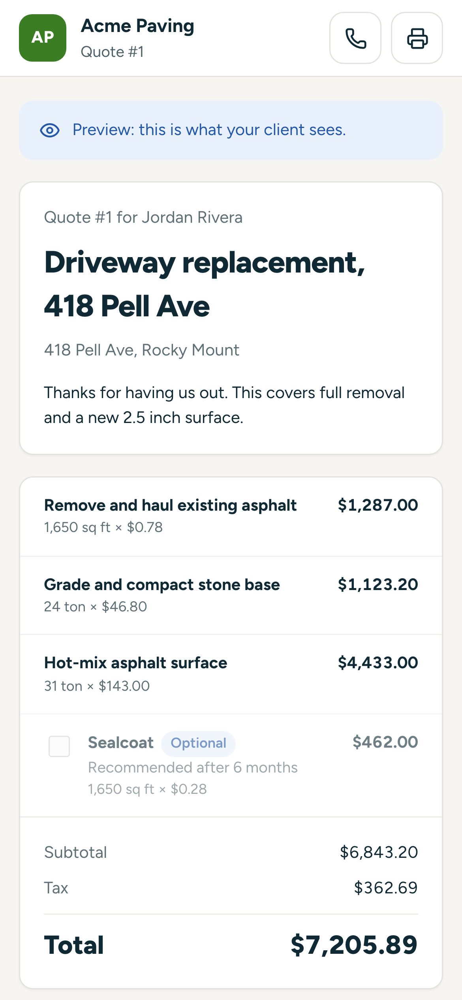

<p align="center">
  <picture>
    <source media="(prefers-color-scheme: dark)" srcset="docs/brand/crewtavo-logo-dark.png">
    
  </picture>
</p>

<p align="center">
  <strong>Open-source operations software for service businesses.</strong><br>
  Requests, quotes, scheduling, crews in the field, invoicing and a client portal, in one app you own.
</p>

<p align="center">
  <a href="https://railway.com/deploy/crewtavo?referralCode=pQ_v0d"></a>
</p>

<p align="center">
  <a href="#deploy-on-railway">Deploy on Railway</a> ·
  <a href="#self-host">Self-host</a> ·
  <a href="#whats-inside">What's inside</a> ·
  <a href="#develop">Develop</a> ·
  <a href="docs/deploy.md">Full deployment guide</a>
</p>

<picture>
  <source media="(prefers-color-scheme: dark)" srcset="docs/images/dashboard-dark.png">
  
</picture>

Crewtavo is for lawn care, paving, roofing, cleaning, HVAC and any trade that quotes work, schedules
crews, works at a property and gets paid. It does what Jobber does, plus an SOP knowledge base,
equipment maintenance, satellite map measuring, and connections to QuickBooks, Zoho, Claude and
ChatGPT.

Every business runs **its own instance**: the app, its own database and its own files, in an
account the business owns. Nobody else holds its data, and there's no per-seat subscription.

## Deploy on Railway

The quickest way to run Crewtavo, and the one that suits a business without a developer.

1. Press **Deploy on Railway** above. Sign in to Railway, or create an account. Railway's free
   trial is enough to try Crewtavo.
2. Press **Deploy**. Railway creates your instance: the Crewtavo app, a Postgres database, and the
   services behind sign-in, data and file storage. Every password and key is generated for you, so
   there's nothing to fill in.
3. After a few minutes, open the address shown on the **crewtavo** service, create the owner account
   and set up your business. Then invite your team from **Settings → People and Roles**.

If something isn't ready yet, that address shows a **Finish setting up** page saying what to do,
instead of an error.

> [!NOTE]
> **Cost.** The business pays Railway directly. A new instance at rest uses about 0.36 GB of
> memory across its five services, roughly $3.60 a month of Railway usage. That fits Railway's
> free trial (30 days, $5 of credit) for trying Crewtavo out, and Railway's Hobby plan ($5 a month,
> including $5 of usage) to keep it running. Busy instances use more; check
> [Railway's pricing](https://railway.com/pricing) for current numbers.

**Your own domain:** in Crewtavo, open **Settings → Web address**, type the address you want (like
`app.yourbusiness.com`) and press **Log in with Railway**. Crewtavo adds the address in Railway and
shows the two DNS records to add where your domain is managed. On Cloudflare, it can add them for
you. It checks the records as they go in and switches over by itself once the new address works.
Links already sent keep working, and the old address forwards to the new one. The screen also
walks you through doing it by hand.

**Email:** Railway blocks outgoing mail servers (SMTP) on its trial and Hobby plans, so on those
plans Crewtavo sends email through [Resend](https://resend.com): create a free Resend account,
then add `RESEND_API_KEY` and `EMAIL_FROM` to the **crewtavo** service's variables. On Railway's Pro
plan, or when you self-host, you can instead connect the business's own mailbox under
**Settings → Email** (Gmail, Google Workspace, Microsoft 365, Zoho, iCloud or any SMTP server).

## Self-host

Crewtavo runs anywhere Docker does: your laptop, an office server or a VPS. It's the same five
services the Railway template creates, described in [`docker-compose.yml`](docker-compose.yml).

You need [Docker](https://docs.docker.com/get-docker/) and [Node.js](https://nodejs.org) 20 or newer
(only to generate the secrets and start Docker; nothing to install).

```bash
git clone https://github.com/jviars/crewtavo.git
cd crewtavo
npm run instance
```

The first run writes `.env.instance` with fresh secrets, builds Crewtavo, starts everything and
prints the address: **http://localhost:8080**. Open it and create the owner account.

> [!IMPORTANT]
> Keep `.env.instance`. The database is locked with the secrets inside it.

```bash
npm run instance -- logs                           # follow what's happening
npm run instance -- stop                           # stop it; the data stays in Docker volumes
npm run instance                                   # start again, or update after a git pull
docker compose --env-file .env.instance down -v    # delete the instance and all its data
```

<details>
<summary><strong>On a server with your own domain</strong></summary>

**Settings → Web address** walks you through these steps with your domain filled in, and checks each one.

1. Point a DNS record for your domain (say `ops.example.com`) at the server.
2. In `.env.instance`, set `APP_URL=https://ops.example.com`, then run `npm run instance` again.
3. Put a web server with HTTPS in front of port 8080. With [Caddy](https://caddyserver.com), this
   whole `Caddyfile` gets a certificate and forwards everything:

   ```
   ops.example.com {
     reverse_proxy localhost:8080
   }
   ```

Only the `crewtavo` container is published (port `CREWTAVO_PORT`, default 8080). It forwards
sign-in, data and files to the other containers over Docker's private network.

**Backups:** the data lives in two Docker volumes, `crewtavo-instance_db-data` (the database) and
`crewtavo-instance_storage-data` (photos and documents). Back up both, along with `.env.instance`.

</details>

<details>
<summary><strong>On Railway, without the template</strong></summary>

[`.railway/railway.ts`](.railway/railway.ts) describes the same instance as Railway Infrastructure
as Code. In an empty Railway project:

```bash
cd .railway && npm install
railway link
railway config apply
```

Then set the two secrets it marks `preserve()` in the dashboard and generate a domain for the
`crewtavo` service. [`deploy/README.md`](deploy/README.md) covers the template itself.

</details>

Optional features (texting, online payments, maps, AI, accounting) each take a key or two. Add them
to the **crewtavo** service's variables on Railway, or to `.env.instance` when self-hosting. See
[Configuration](#configuration).

## What's inside

<table>
  <tr>
    <td width="50%" valign="top">
      
      <p><strong>Schedule.</strong> Day and week time grids with a lane per crew, a month view,
      drag to move or resize, double-booking warnings, rain-day shifts and route order. The board
      keeps itself up to date as others make changes, and everyone can add their schedule to
      Google, Apple or Outlook Calendar. Calendars from Google, Zoho, Outlook, iCloud or any ICS
      link show alongside the visits, and Find a time steers around them.</p>
    </td>
    <td width="50%" valign="top">
      
      <p><strong>Quotes.</strong> Line items from your price list, formulas and satellite map
      measurements, optional add-ons, deposits and promo codes. Clients approve and sign online.</p>
    </td>
  </tr>
  <tr>
    <td width="50%" valign="top">
      
      <p><strong>Sales board.</strong> Every request and quote from first call to approval, with
      what's open, won and lost.</p>
    </td>
    <td width="50%" valign="top">
      
      <p><strong>Reports.</strong> Sales, work, money, team and clients, a yearly revenue goal, and
      unpaid invoices by age. Everything exports to CSV.</p>
    </td>
  </tr>
  <tr>
    <td width="50%" valign="top">
      
      <p><strong>Equipment.</strong> Trucks, trailers and machines with hour meters and odometers,
      maintenance schedules by date, hours or miles, service history and costs.</p>
    </td>
    <td width="50%" valign="top">
      
      <p><strong>Knowledge base.</strong> Your SOPs, with an editor, revision history and required
      reading for the crew.</p>
    </td>
  </tr>
</table>

<table>
  <tr>
    <td width="33%" valign="top" align="center">
      
    </td>
    <td width="33%" valign="top" align="center">
      
    </td>
    <td width="34%" valign="top">
      <p><strong>In the field.</strong> <em>My day</em> on any phone: on my way, start and finish,
      gate codes, checklists with signatures, photos, materials used and a crew clock. It keeps
      working with no signal and catches up when the connection is back.</p>
      <p><strong>For your clients.</strong> The Client Hub, with no account to create: approve
      quotes, pay invoices (with an optional tip), see the next visit, ask for changes, request
      work and message the office.</p>
    </td>
  </tr>
</table>

**And also:**

- **Jobs and invoicing:** one-off and recurring jobs, multi-day work, change orders the client
  approves, batch invoicing, payment reminders, deposits, progress billing and retainage. Invoices
  go through Stripe for card and bank payments; invoices made in Stripe come in too, with the fees
  and bank deposits behind every payment. Refunds, expenses and job costing, timesheets.
- **People and roles:** General manager, Office manager, Operations manager, Foreman and Employee
  to start with, renamable, plus your own. A foreman runs their crew and never sees prices. The
  database enforces every rule, not just the screens.
- **Communication:** email from your own mailbox, two-way texting through Twilio, a message center,
  and notifications in the app, by email, by text or as phone push, each person's choice.
- **Automations and marketing:** rules like "when a quote is sent, wait 3 days, then email the
  client", campaigns, promo codes, Google review requests and referrals.
- **Claude and ChatGPT:** a built-in connector. Each person signs in with their own account, an
  assistant can only do what that person's role allows, and every call is logged.
- **Every trade:** trade presets ([`packages/core/src/presets`](packages/core/src/presets)) load
  starter services, quote formulas, checklists, booking forms and SOP categories when a company
  signs up: lawn and exterior maintenance, paving and sitework, roofing and exteriors, or a general
  starting point for any other trade.

## How it fits together

```
One instance per business: a Railway project, or docker compose on your own machine

Browser: React app (desktop and phone layouts, works offline in the field)
  └──► crewtavo  (the only public service: apps/api/src/server.ts)
         ├── the web app, and /api/* (Hono), acting as the signed-in user
         │     ├── QuickBooks Online, Zoho Books, Google Calendar (OAuth, tokens encrypted)
         │     ├── other calendars' ICS links (Zoho, Outlook, iCloud...), read every 15 minutes
         │     ├── Stripe, the company's mailbox or Resend, Twilio, Google Maps, Open-Meteo, Claude
         │     └── /mcp ◄── Claude and ChatGPT (OAuth through the instance's own sign-in)
         ├── background tasks: automations, reminders, recurring visits, weather holds
         ├── database migrations, applied on every start
         └── forwards to the instance's own services over the private network:
               /auth/v1     → auth      (Supabase Auth: sign-in, invitations, password resets)
               /rest/v1     → rest      (PostgREST, with row-level security)
               /storage/v1  → storage   (photos, receipts and documents)
                                all backed by db (Postgres)
```

The `crewtavo` service derives every service key from one shared secret and sets up the database
itself, so a new instance needs nothing copied by hand.

## Configuration

Everything an instance needs is generated. These optional settings turn on extra features.
[`.env.example`](.env.example) lists them all.

<details>
<summary><strong>Optional settings</strong></summary>

| Name | Turns on |
| --- | --- |
| `APP_URL` | Your own domain. **Settings → Web address** sets it on Railway. Defaults to the instance's address. |
| `ENCRYPTION_KEY` | A separate key for app tokens and client links (32+ characters). Keep it stable once set: changing it disconnects every app and invalidates links already sent. |
| `ANTHROPIC_API_KEY`, `AI_MODEL` | AI rewriting and answers from your SOPs. Companies can also add their own key on the Apps page. |
| `GOOGLE_MAPS_BROWSER_KEY`, `GOOGLE_MAPS_SERVER_KEY` | Measuring on satellite imagery, and roof pitch suggestions (Solar API). |
| `STRIPE_SECRET_KEY`, `STRIPE_WEBHOOK_SECRET` | A Stripe account shared by every company on the server. Usually not needed: each business connects its own Stripe on the Apps page. |
| `TWILIO_ACCOUNT_SID`, `TWILIO_AUTH_TOKEN`, `TWILIO_FROM_NUMBER` | Text messages, and two-way texting. |
| `RESEND_API_KEY`, `EMAIL_FROM` | Email through Resend. Needed on Railway's trial and Hobby plans, which block SMTP; elsewhere, a default sender until the business connects its own mailbox. |
| `QUICKBOOKS_CLIENT_ID`, `QUICKBOOKS_CLIENT_SECRET` | QuickBooks Online sync. |
| `ZOHO_CLIENT_ID`, `ZOHO_CLIENT_SECRET`, `ZOHO_ACCOUNTS_URL` | Zoho Books sync. |
| `GOOGLE_CLIENT_ID`, `GOOGLE_CLIENT_SECRET` | Google Calendar sign-in: its calendars on the schedule, and visits on a Google calendar. Calendars added by ICS link (Zoho, Outlook, iCloud, Google's secret address) need nothing. |
| `TURNSTILE_SITE_KEY`, `TURNSTILE_SECRET_KEY` | Bot protection on public booking and referral forms. |
| `CREWTAVO_SENTRY_DSN` | Error reports to Sentry or a self-hosted GlitchTip, with personal data removed. |
| `CREWTAVO_SCHEDULER` | Set to `off` on extra replicas so background tasks run in one place. |

[docs/deploy.md](docs/deploy.md) has the details for each one (webhook addresses, the events to
send, how error reports are scrubbed).

</details>

## Develop

You need Node 20+ and Docker. The quick loop runs the API and the web app on your machine against
a local Supabase:

```bash
npm install
npx supabase start               # local Supabase; applies supabase/migrations
cp .dev.vars.example .dev.vars   # paste the URL and keys that `supabase start` printed
npm run dev:api                  # API on :8787, restarting on changes, with the background tasks
npm run dev                      # web app on :5173, proxying /api to :8787
npm run seed:demo                # optional: a demo paving company with a week of work
```

Open http://localhost:5173 and sign in as `demo@crewtavo.test` (password `crewtavo-demo`), or create
your own account. Email goes to Mailpit at http://localhost:56324; set
`MAILPIT_URL=http://localhost:56324` in `.dev.vars` and the app's own emails and texts land there
too. Supabase Studio is at http://localhost:56323.

```bash
npm run typecheck      # every package
npm test               # core, API and web unit tests
npm run test:db        # migrations and row-level security tests in Docker Postgres
npm run test:e2e       # a job from new client to paid invoice, as four different roles
npm run test:browser   # the core flows clicked through in Chromium, with accessibility checks
npm run db:types       # regenerate database types after changing migrations
npm run screenshots    # retake the images in this README
```

`test:e2e` and `test:browser` need the local stack running and `npm run seed:demo` loaded. CI
([`.github/workflows/ci.yml`](.github/workflows/ci.yml)) runs all of them, and also starts a whole
instance with docker compose to check that it comes up ready for its owner.

### Repository layout

| Path | What's there |
| --- | --- |
| [`apps/web`](apps/web) | The React + TypeScript + Vite web app |
| [`apps/api`](apps/api) | The Hono API. `src/server.ts` serves it with the web app, runs background tasks and migrations, and fronts the instance's services (`src/lib/stack.ts`) |
| [`packages/core`](packages/core) | Shared logic: map geometry, quote formulas, recurrence, time zones, roles, trade presets, database types |
| [`supabase`](supabase) | Migrations (schema, row-level security, database functions) and database tests |
| [`deploy`](deploy) | The instance's Postgres image and the [Railway template guide](deploy/README.md) |
| [`e2e`](e2e) | Playwright browser tests |
| [`scripts`](scripts) | Server build, migrations, `npm run instance`, the dev API, seeding, screenshots |
| [`docs`](docs) | The [deployment guide](docs/deploy.md), the [implementation plan](docs/implementation-plan.md), brand files and these screenshots |

## Status

Crewtavo works end to end: a whole instance starts on its own with docker compose, applies every
migration, and goes from owner setup to a working business. The Railway template is new, so
[report anything](https://github.com/jviars/crewtavo/issues) that goes wrong on a first deploy.
QuickBooks and Zoho sync are written but not yet tested against live accounts.

## License

Free to use, change and share under the [Crewtavo License](LICENSE): BSD 3-Clause plus a branding
clause. Keep the Crewtavo name and logo, including "Powered by Crewtavo" in the Client Hub; your
own business name, logo and colors are always fine. Instances with 50 or fewer people signing in
may remove the Crewtavo branding too. Crewtavo comes with no warranty; see [LICENSE](LICENSE) for
the full terms.
